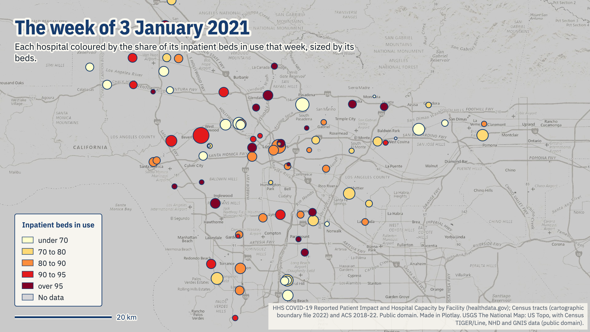
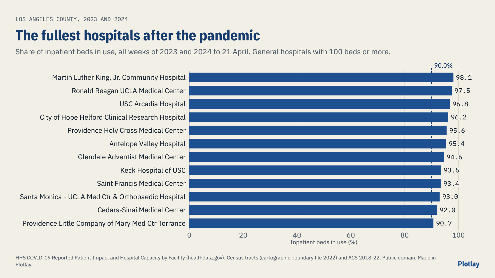
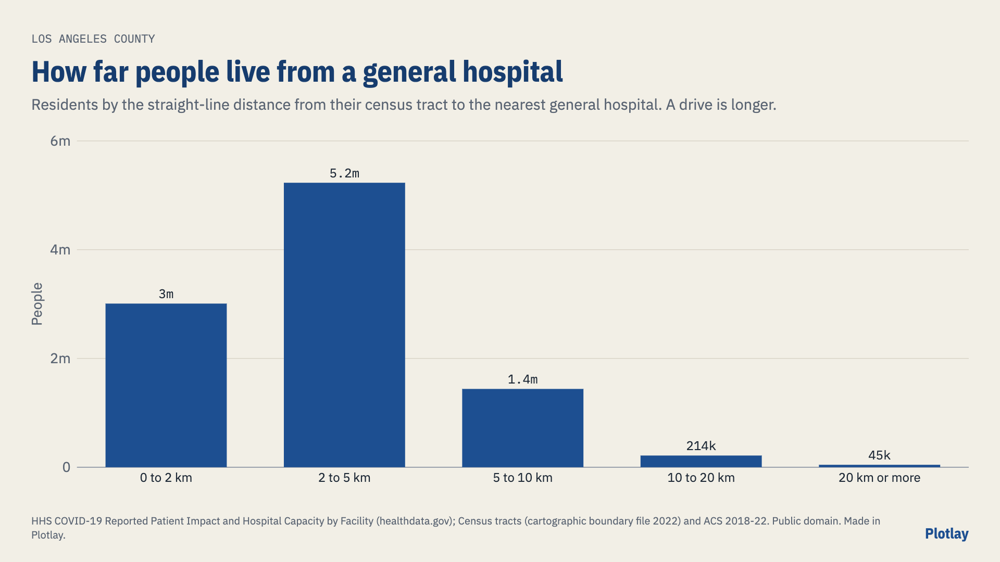

# How full were Los Angeles County's hospitals?

Every hospital in Los Angeles County that reported to the U.S. Department of Health and Human Services, week by week from June 2020 to April 2024, and every census tract by how far its people live from a general hospital. **Live version, with an interactive map:** [getplotlay.com/showcase/la-hospital-beds](https://www.getplotlay.com/showcase/la-hospital-beds/)



In the week of 3 January 2021, Los Angeles County's hospitals held **8,316 COVID-19 patients** (a 7-day average). 80.6% of their 19,773 inpatient beds were in use, and staffed adult ICU beds peaked at 91.6% two weeks later. 32 of the 83 hospitals reporting that week were 90% full or fuller.

The surge ended; the strain did not, for some hospitals. In the week of 5 March 2023, with 609 COVID-19 patients, the county's beds were 80.9% in use, the same share as at the peak, because 2,173 fewer beds were reported than in the peak week, when surge beds were open. Across 2023 and 2024, **16 of 74 general hospitals averaged 90% or fuller**.

HHS publishes each hospital as a row with an address, week by week, with no area and no people. The Census Bureau publishes people by tract, with no hospitals. [Plotlay](https://www.getplotlay.com) puts both on one map: the hospitals keyed by their CMS number with the week on a slider, the tracts keyed by their GEOID with the distance to the nearest general hospital.

[](https://app.plotlay.io/?example=la-hospital-beds&as=client)

## What the data says

| | |
|---|---|
| Hospitals that reported | 86 (76 general, 7 long term care, 2 children's, 1 critical access) |
| COVID-19 patients, the busiest week (3 Jan 2021) | 8,316 |
| Inpatient beds in use that week | 80.6% of 19,773 |
| Staffed adult ICU beds in use, the fullest week (17 Jan 2021) | 91.6% |
| Inpatient beds in use, 5 Mar 2023 (609 COVID-19 patients) | 80.9% of 17,601 |
| Inpatient beds in use, the median week of 2023-24 | 77.1% |
| General hospitals averaging 90% or fuller in 2023-24 | 16 of 74 |

The fullest general hospitals with 100 beds or more in 2023-24: Martin Luther King, Jr. Community Hospital 98.1%; Ronald Reagan UCLA Medical Center 97.5%; USC Arcadia Hospital 96.8%; City of Hope Helford Clinical Research Hospital 96.2%; Providence Holy Cross Medical Center 95.6%.



### How far people live from a general hospital

| Straight-line distance from the tract | People | Share |
|---|---|---|
| 0 to 2 km | 3,007,857 | 30.3% |
| 2 to 5 km | 5,231,063 | 52.6% |
| 5 to 10 km | 1,439,024 | 14.5% |
| 10 to 20 km | 213,769 | 2.1% |
| 20 km or more | 44,977 | 0.4% |

Half of the county's 9,936,690 residents live within 2.84 km (1.8 mi) in a straight line of a general hospital. In the Antelope Valley, the tracts nearest Antelope Valley Hospital or Palmdale Regional Medical Center hold 411,291 people, 7.58 km from their nearest hospital on average, with 1.09 beds per 1,000 people within 10 km (the county: 1.67). Antelope Valley Hospital was 90% full or fuller in 190 of 203 weeks.



### Read it carefully

- **The data stopped in May 2024.** HHS's facility file was updated weekly while hospitals had to report; its last week is 21 April 2024. A week here is a 7-day average, Sunday to Saturday.
- **Beds are what each hospital reported**, staffed inpatient beds including surge and overflow beds. The count fell after the surge, so a share in use can hold steady while fewer patients are in hospital.
- **The bed counts step down in the week of 12 July 2020**, the first week the file reports staffed ICU beds, so the beds chart starts there.
- **Small counts are suppressed.** HHS replaces counts under 4 with -999999; they are left blank here, never zero. County totals add up the hospitals that reported that week.
- **Two records are not hospitals of their own.** 05T782 repeats Casa Colina Hospital week for week from December 2022, so it is dropped; 05T485 was a 42-bed temporary site at MemorialCare Long Beach Medical Center in November and December 2020, so its beds are added to that hospital's.
- **Distances are straight lines** from the middle of each tract (a point inside it) to the nearest general hospital (short term or critical access) reporting in 2023-24, not drive times. Walking and drive-time catchments are not in Plotlay yet; a drive is longer, and freeways and hills make it more so.
- **Beds per 1,000 people within 10 km** is a two-step ratio: each hospital's beds are shared out among everyone within 10 km of it, then each tract adds up its shares. It ignores the county line, so the edges of the county read low.
- **No patient-level data.** Everything here is a weekly total per hospital as HHS published it.
- **Names** are HHS's, in title case with acronyms restored (LAC, UCLA, USC, PIH, UCI); two misspellings in the source ("Memoriacare", "Cedar-Sinai") are corrected.

## How it was made with Plotlay

1. **A map project** on the USGS National Map topo base map (public domain), and two **Data layers**.
2. **Hospitals: Take all** from one file: each of the 86 hospitals a disc 1 km across at its HHS address (big enough to see across the county), keyed by its CMS number (`hospital_pk`).
3. **Link by key** each hospital's summary, then one row per hospital and week (17,031 rows, 203 weeks) as a **time axis**.
4. **A formula column**: the weeks each hospital was 90% full or fuller, `count(occupancy >= 90)`.
5. **Colour by the share of beds in use** for the week on the slider, and play it.
6. **Tracts: Take all** from the Census tracts file (2,495 tracts, keyed by `geoid`), linked to each tract's people and distance, coloured by distance.
7. **Charts and map pictures** in the Analysis workspace; **export** GeoJSON, TopoJSON, CSV with WKT and the linked data. Nothing in this repository comes from OpenStreetMap.

## What's here

| Folder | What |
|---|---|
| [`data/geometry/`](data/geometry) | The hospitals (key `hospital_pk`) and the census tracts (key `geoid`) from Plotlay: GeoJSON, TopoJSON, CSV with WKT |
| [`data/tables/`](data/tables) | `hospitals.csv`, `hospital_weeks.csv` (what the slider shows), `county_weeks.csv`, `tract_access.csv` |
| [`python/`](python) | A narrated notebook that recomputes every number here: [`hospital_beds.ipynb`](python/hospital_beds.ipynb) |
| [`powerbi/`](powerbi) | A Power BI Project (`.pbip`). Start with [`powerbi/OPEN-ME.md`](powerbi/OPEN-ME.md) |
| [`visuals/`](visuals) | The map pictures and charts, made in Plotlay from the same layers |

### Run the notebook

```
python3 -m venv .venv
.venv/bin/pip install -r python/requirements.txt
cd python && ../.venv/bin/jupyter lab hospital_beds.ipynb
```

### Open the Power BI report

Open `powerbi/LAHospitalBeds.pbip` in Power BI Desktop and select Refresh. [`powerbi/OPEN-ME.md`](powerbi/OPEN-ME.md) has the steps.

## Sources and licences

- **Code** (notebook, Power BI project): MIT, see [`LICENSE`](LICENSE).
- **Our data** (the tables and shapes): CC BY 4.0, see [`LICENSE-DATA`](LICENSE-DATA). Credit "Plotlay (getplotlay.com)" and the sources below.
- COVID-19 Reported Patient Impact and Hospital Capacity by Facility (anag-cw7u): U.S. Department of Health and Human Services, healthdata.gov. A U.S. Government work, public domain.
- Census tracts (cartographic boundary file 2022, 1:500,000) and American Community Survey 2018-2022 5-year estimates (table B01003, total population): U.S. Census Bureau. Public domain.
- Base map in the app: USGS The National Map, US Topo (public domain).

This is independent work using open data, not endorsed by HHS, the Census Bureau or any hospital. Full credits are in [`NOTICE`](NOTICE).
